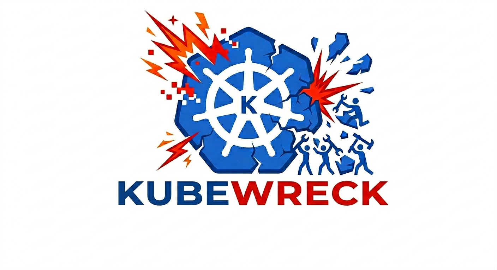

<p align="center" width="100%">
    <kbd>
        
    </kbd>
</p>

# Kubewreck App

This is a demo application which renders an HTML page with a team name from PostgreSQL and
instructions on how to upgrade the application in kubernetes.

In our `kubewreck` challenges, we tinker with kubernetes resources
and maliciously block the straight forward upgrade path.
After the teams manages to mitigate all issues, the `v2` Image
displays a new version of the page


## Build

See [application setup](app/README.md#postgresql-setup) for database provisioning,
environment configuration, and local development.

Build App and Image via:

```
task build
```

Push Image to ghcr with
```
task push
```
